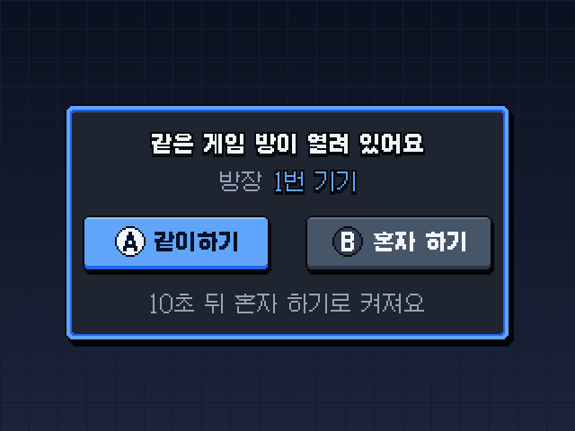
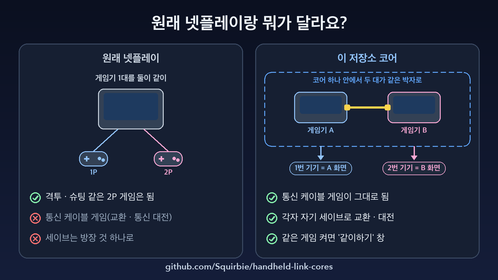
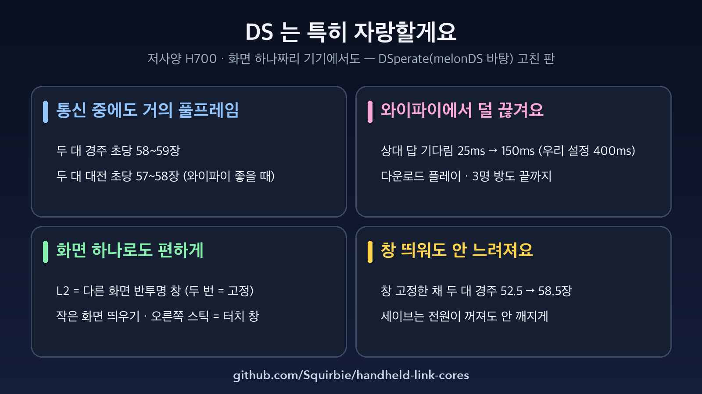
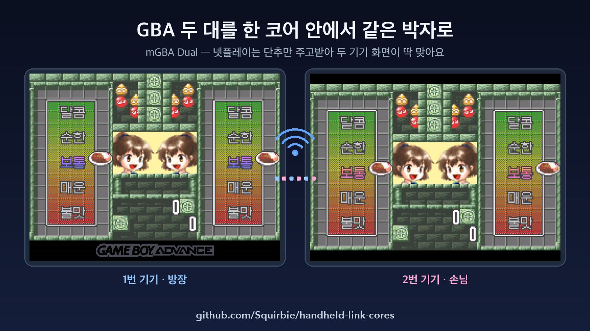
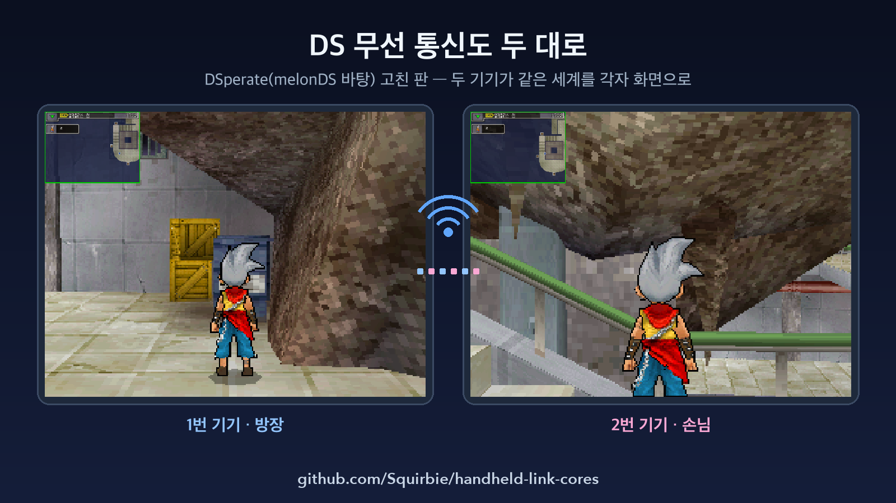
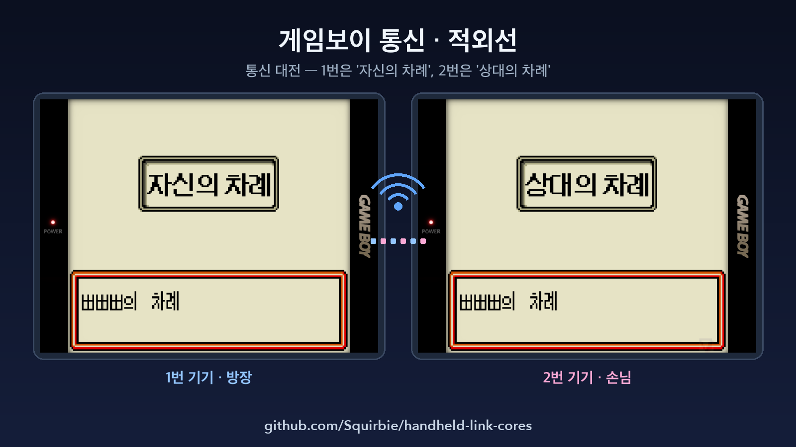
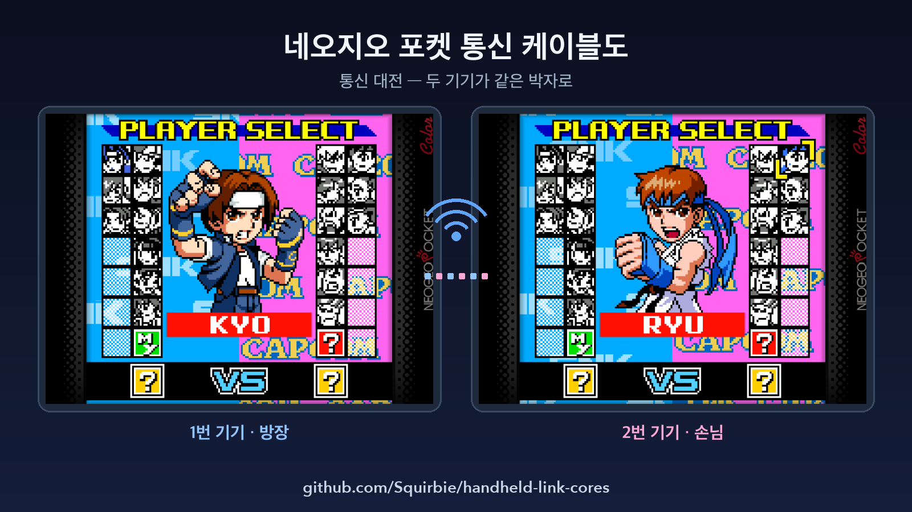
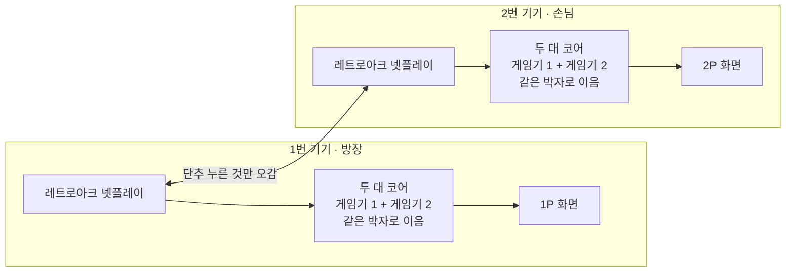

<p align="center"><a href="README.md"></a><a href="README.ko.md"></a></p>

<p align="center">
  <picture>
    <source media="(prefers-color-scheme: dark)" srcset="docs/images/banner-dark-ko.svg">
    <source media="(prefers-color-scheme: light)" srcset="docs/images/banner-light-ko.svg">
    
  </picture>
</p>

<p align="center">
  <a href="https://github.com/Squirbie/handheld-link-cores/releases/latest"></a>
  
  
  
  <a href="#라이선스"></a>
</p>

<p align="center">
  <b>통신 케이블 게임을 휴대용 게임기 두 대로, 와이파이로.</b><br>
  레트로아크 넷플레이를 게임보이 · GBA · 원더스완 · 네오지오 포켓 · 게임기어의 통신 케이블로 바꾸는 코어,
  집 와이파이에서도 잘 버티는 DS 무선 통신, 오락실 · MSX 넷플레이가 어긋나지 않게 하는 고침, IPX 넷플레이 때 꺼지지 않는 DOS 를 모았어요.
</p>

<p align="center">
  <a href="#한눈에">한눈에</a> ·
  <a href="#무엇이-들었나">무엇이 들었나</a> ·
  <a href="#받기">받기</a> ·
  <a href="#빠르게-시작-knulli">빠르게 시작</a> ·
  <a href="#어떻게-이어지나">어떻게 이어지나</a> ·
  <a href="#자주-묻는-것">자주 묻는 것</a> ·
  <a href="#라이선스">라이선스</a>
</p>

---

## 한눈에

<table>
<tr>
<td width="33%" valign="top">

**🔗 와이파이로 잇는 통신 케이블**

한 코어 안에서 게임기 두 대를 같은 박자로 돌리고, 레트로아크 넷플레이가 두 기기를 똑같이 맞춰요. GBA · 원더스완 · 네오지오 포켓 · 게임기어 통신 게임이 진짜 케이블을 꽂은 것처럼 돌아가요.

</td>
<td width="33%" valign="top">

**📡 DS 무선 통신**

DSperate(melonDS 바탕)로 두 기기를 집 네트워크에서 이어요. 끊김이 훨씬 줄었고, 다운로드 플레이 · 세 명 방 · 같은 게임끼리 자동으로 붙기도 돼요.

</td>
<td width="33%" valign="top">

**🎮 게임보이 통신 · 적외선**

감바테가 바이트 하나하나의 박자를 게임마다 정한 시간 안에 맞추고, 게임보이 컬러 적외선도 넷플레이로 이어요.

</td>
</tr>
<tr>
<td width="33%" valign="top">

**💾 각자 자기 세이브**

손님의 세이브가 방장 기기의 2P 칸에 들어가 함께 놀고, 끝나면 손님 기기로 돌아가요. 서로 이어지는 다른 판끼리(짝 게임)도 붙어요.

</td>
<td width="33%" valign="top">

**🕹️ 어긋나지 않는 오락실 넷플레이**

MAME 2003-Plus 상태 저장에 스케줄러 · 타이머 · IRQ 대기줄 · 기판 메모리를 담아 손님 화면이 더는 어긋나지 않아요. FBNeo 의 타이토 F3 상태는 4.8MB 에서 0.63MB 로 줄었어요.

</td>
<td width="33%" valign="top">

**🧰 작지만 중요한 고침**

MSX 게임 안 저장이 파일로 남고, 패미컴 매퍼 14 에 작업용 램이 생기고, DOS IPX 넷플레이가 꺼지지 않고, 오락실 마작 키를 패드로 쳐요.

</td>
</tr>
</table>

<p align="center">
  
</p>
<p align="center"><sub>둘째 기기에서 같은 게임을 켜면 이미 열린 방에 같이할지 물어요 — 메뉴도, 주소 입력도 없어요. 10초 안에 안 고르면 혼자 하기로 켜져요.</sub></p>

## 예시 화면

와이파이로 이은 RG35XX Pro 두 대의 실제 화면이에요. 왼쪽이 1번 기기(방장), 오른쪽이 2번 기기(손님)예요.

<table>
<tr>
<td width="50%"></td>
<td width="50%"></td>
</tr>
<tr>
<td></td>
<td></td>
</tr>
<tr>
<td></td>
<td></td>
</tr>
</table>

## 무엇이 들었나

| 기종 | 꾸러미 | 무엇을 고쳤나 | 바탕 |
|---|---|---|---|
| 닌텐도 DS | [`ds-melonds-ds`](cores/ds-melonds-ds/README.ko.md) | 큰 롬 파일을 램에 다 올리지 않고 매핑해서 256~512MB 게임이 메모리 부족으로 꺼지지 않아요. 두 기기 넷플레이 기다림을 고치고(진짜 시계 · 빈 답도 답으로 셈) DraStic 같은 조작 · 화면 배치 · 왼쪽 위 작은 화면을 더했어요. | [melonDS DS](https://github.com/JesseTG/melonds-ds) v1.4.0 |
| 닌텐도 DS | [`ds-dsperate`](cores/ds-dsperate/README.ko.md) | 와이파이로 두 기기 무선 통신을 끊김 없이 해요. 손님 없는 방장은 혼자 하기, fsync 세이브, 같은 게임끼리 자동으로 붙는 그룹, 세 명 같이하기, 다운로드 플레이 고침, 펌웨어 덤프가 없을 때 흰 화면이던 IPC FIFO 박자 고침이 들었어요. | [DSperate](https://github.com/beebono/DSperate) v3.0.3 |
| 게임보이 · 컬러 | [`gb-gambatte-link`](cores/gb-gambatte-link/README.ko.md) | 레트로아크 넷플레이 방을 통신 케이블과 GBC 적외선으로 써요. 바이트 사이 시간을 맞춰 게임마다 정한 시간 제한을 넘기고, 감바테의 직렬 바이트 밀림과 부트롬 중 리셋 버그를 고쳤어요. | [gambatte-libretro](https://github.com/libretro/gambatte-libretro) `4041d5a` |
| 게임보이 어드밴스 | [`gba-mgba-dual`](cores/gba-mgba-dual/README.ko.md) | 한 코어 안에서 GBA 두 대를 같은 박자의 케이블로 이어, 통신 케이블 게임을 넷플레이로 해요. 누가 먼저 들어가도 붙고, 각자 자기 세이브, 짝 게임, 팩 하나로 여럿이 하는 싱글팩(2P 를 팩 없이 바이오스로)까지 돼요. | [mgba](https://github.com/libretro/mgba) `7a12d6d` + [tangobattle/mgba](https://github.com/tangobattle/mgba) |
| 게임보이 어드밴스 | [`gba-gpsp-rfu`](cores/gba-gpsp-rfu/README.ko.md) | GBA 무선 어댑터(RFU)가 와이파이 지연 · 몰아 오기에도 버텨요: 패킷 줄 128칸, 1.2초 끊김 판단, 늦은 답 보존, 기다림 줄이기. 포켓몬 파이어레드 · 리프그린 · 에메랄드 교환 · 대전용이에요. | [gpsp](https://github.com/libretro/gpsp) `4caf7a1` |
| 원더스완 | [`wswan-mednafen-dual`](cores/wswan-mednafen-dual/README.ko.md) | 한 코어에 원더스완 두 대와 다시 쓴 직렬 포트를 넣고, 두 기기에서 똑같은 상태 저장을 만들어요. 각자 세이브 · 세로 화면 · 게임별 박자 · 상해 포켓 모드 · 짝 게임을 더했어요. | [beetle-wswan-libretro](https://github.com/libretro/beetle-wswan-libretro) `4b01295` |
| 네오지오 포켓 | [`ngp-mednafen-dual`](cores/ngp-mednafen-dual/README.ko.md) | 직렬 채널 0 과 바이오스 통신 함수로 두 대를 잇고, 시계 · 플래시 · Z80 상태를 결정적으로 만들었어요. 각자 세이브와 짝 게임(카드 파이터즈 SNK ↔ 캡콤, 다이브 얼러트 베키 ↔ 매트)을 더했어요. | [beetle-ngp-libretro](https://github.com/libretro/beetle-ngp-libretro) `139fe34` |
| 게임기어 | [`gg-genesisplusgx-dual`](cores/gg-genesisplusgx-dual/README.ko.md) | 기어 투 기어 케이블(병렬 · 직렬 UART · NMI)을 흉내 내 두 대를 줄 단위로 번갈아 돌려요. 각자 자기 세이브도 돼요. | [Genesis Plus GX](https://github.com/libretro/Genesis-Plus-GX) `302fe82` |
| MSX | [`msx-bluemsx`](cores/msx-bluemsx/README.ko.md) | 게임 안 저장(카트리지 SRAM · 플래시)이 파일로 남고, 디스크 바꾸기가 먹고, 상태 저장이 빠짐없고 늘 같아서 두 기기 넷플레이가 갈라지지 않아요. | [blueMSX-libretro](https://github.com/libretro/blueMSX-libretro) `572c918` |
| 패미컴 | [`nes-fceumm-mapper14`](cores/nes-fceumm-mapper14/README.ko.md) | 매퍼 14(SL1632)에 작업용 램 8KB 를 붙이고 $6000~$7FFF 쓰기를 그 램으로 보내, Downtown Special 한글화 롬의 검은 화면을 고쳤어요. | [libretro-fceumm](https://github.com/libretro/libretro-fceumm) `63643ba` |
| DOS | [`dos-dosbox-pure-ipx`](cores/dos-dosbox-pure-ipx/README.ko.md) | 넷플레이가 시작되면 DOS 를 한 번 다시 켜서 IPX · 모뎀이 처음부터 켜지게 했어요. 헤러틱 · 헥센 IPX 방을 열 때 레트로아크가 꺼지지 않아요. | [DOSBox Pure](https://codeberg.org/schelling/dosbox-pure) 0.9.9 |
| 오락실 | [`arcade-mame2003-plus`](cores/arcade-mame2003-plus/README.ko.md) | 상태 저장에 스케줄러 · 타이머 · IRQ 대기줄 · CPU · 기판별 비디오 메모리를 담아 넷플레이 손님 화면이 비거나 어긋나지 않아요. '소리 불완전 · 색 틀림' 표시 게임도 다시 상태 저장이 되고, 읽기 전용 큰 롬 뱅크는 상태에서 빠져요. | [mame2003-plus-libretro](https://github.com/libretro/mame2003-plus-libretro) `61305d6` |
| 오락실 | [`arcade-fbneo`](cores/arcade-fbneo/README.ko.md) | 순정 코어의 기계어 9바이트만 고쳤어요: EEPROM 을 넷플레이 상태에 담고, 타이토 F3 의 안 쓰는 4MB DRAM 을 빼고(4.8MB → 0.63MB), 한 드라이버 입력표에서 P3/P4 START 가 2P 위/아래를 덮던 것을 고쳤어요. | [FBNeo](https://github.com/libretro/FBNeo) v1.0.0.03 |
| 오락실 | [`arcade-mahjong-pad`](cores/arcade-mahjong-pad/README.ko.md) | 키보드로만 받는 오락실 마작 키(A~N · 깡 · 퐁 · 치 · 리치 · 론)를 패드로 답하는 감싸개 코어예요. 화면 아래에 A~N 줄을 그려요. | FBNeo · MAME 2003-Plus 를 감쌈 |

폴더마다 README(영어 · 한국어)에 기준 커밋, 거는 순서대로 패치, 코어 옵션, 넣는 법, 원본 라이선스가 있어요.
KNULLI 에 붙이는 것(같이하기 창 · 각자 세이브 · DS 직접 연결 · PSP 애드혹 중계)은 [`knulli-scripts/`](knulli-scripts/README.ko.md) 에 있어요.

## 받기

릴리즈는 날짜로 이름 붙여요(`YYYY.MM.DD`). 꾸러미마다 미리 빌드한 파일, 이름을 바꾼 코어의 `.info` 파일, 원본 라이선스, 짧은 안내가 들어 있어요. 지문은 [`SHA256SUMS.txt`](https://github.com/Squirbie/handheld-link-cores/releases/latest/download/SHA256SUMS.txt) 에 있어요.

| 꾸러미 | 들어 있는 것 | 크기 |
|---|---|---|
| [**전부**](https://github.com/Squirbie/handheld-link-cores/releases/latest/download/handheld-link-cores-all-linux-aarch64.zip) | 아래 꾸러미 모두를 한 zip 으로 | 44.1 MB |
| [ds-melonds-ds](https://github.com/Squirbie/handheld-link-cores/releases/latest/download/ds-melonds-ds-linux-aarch64.zip) | `melondsds_libretro.so` | 2.0 MB |
| [ds-dsperate](https://github.com/Squirbie/handheld-link-cores/releases/latest/download/ds-dsperate-linux-aarch64.zip) | `dsperate` + 켜기 파일 | 3.2 MB |
| [gb-gambatte-link](https://github.com/Squirbie/handheld-link-cores/releases/latest/download/gb-gambatte-link-linux-aarch64.zip) | `gambatte_libretro.so` | 474 KB |
| [gba-mgba-dual](https://github.com/Squirbie/handheld-link-cores/releases/latest/download/gba-mgba-dual-linux-aarch64.zip) | `mgba_dual_libretro.so` + `.info` | 387 KB |
| [gba-gpsp-rfu](https://github.com/Squirbie/handheld-link-cores/releases/latest/download/gba-gpsp-rfu-linux-aarch64.zip) | `gpsp_libretro.so` | 297 KB |
| [wswan-mednafen-dual](https://github.com/Squirbie/handheld-link-cores/releases/latest/download/wswan-mednafen-dual-linux-aarch64.zip) | `mednafen_wswan_dual_libretro.so` + `.info` | 215 KB |
| [ngp-mednafen-dual](https://github.com/Squirbie/handheld-link-cores/releases/latest/download/ngp-mednafen-dual-linux-aarch64.zip) | `mednafen_ngp_dual_libretro.so` + `.info` | 216 KB |
| [gg-genesisplusgx-dual](https://github.com/Squirbie/handheld-link-cores/releases/latest/download/gg-genesisplusgx-dual-linux-aarch64.zip) | `genesisplusgx_gg_dual_libretro.so` + `.info` | 1.7 MB |
| [msx-bluemsx](https://github.com/Squirbie/handheld-link-cores/releases/latest/download/msx-bluemsx-linux-aarch64.zip) | `bluemsx_libretro.so` | 740 KB |
| [nes-fceumm-mapper14](https://github.com/Squirbie/handheld-link-cores/releases/latest/download/nes-fceumm-mapper14-linux-aarch64.zip) | `fceumm_libretro.so` | 520 KB |
| [dos-dosbox-pure-ipx](https://github.com/Squirbie/handheld-link-cores/releases/latest/download/dos-dosbox-pure-ipx-linux-aarch64.zip) | `dosbox_pure_hb_ipx_libretro.so` | 1.2 MB |
| [arcade-mame2003-plus](https://github.com/Squirbie/handheld-link-cores/releases/latest/download/arcade-mame2003-plus-linux-aarch64.zip) | `mame2003_plus_libretro.so` | 10.0 MB |
| [arcade-fbneo](https://github.com/Squirbie/handheld-link-cores/releases/latest/download/arcade-fbneo-linux-aarch64.zip) | `fbneo_libretro.so` | 21.0 MB |
| [arcade-mahjong-pad](https://github.com/Squirbie/handheld-link-cores/releases/latest/download/arcade-mahjong-pad-linux-aarch64.zip) | `fbneo_mj_libretro.so` + `mame2003_plus_mj_libretro.so` + `.info` | 25 KB |
| [knulli-scripts](https://github.com/Squirbie/handheld-link-cores/releases/latest/download/knulli-scripts.zip) | 붙이는 스크립트 · 실행기 패치 · 갈무리 픽셀 글꼴 | 2.1 MB |

롬 · 바이오스 · 펌웨어 · 세이브는 들어 있지 않아요. 쓸 수 있는 파일만 쓰세요.

## 빠르게 시작 (KNULLI)

기기에 SSH 로(root) 들어가서 한 줄이면 돼요. 아래 표에서 꾸러미 이름을 고르세요.

```sh
curl -fsSL https://raw.githubusercontent.com/Squirbie/handheld-link-cores/main/install.sh | sh -s -- gba-mgba-dual knulli-scripts
```

`curl` 이 없으면: `wget -qO- https://raw.githubusercontent.com/Squirbie/handheld-link-cores/main/install.sh | sh -s -- gba-mgba-dual`

스크립트를 먼저 읽어 보거나 번호 목록에서 고르고 싶다면 저장한 뒤 실행하세요.

```sh
curl -fsSL -o install.sh https://raw.githubusercontent.com/Squirbie/handheld-link-cores/main/install.sh
sh install.sh            # 번호 목록
sh install.sh --list     # 꾸러미 이름과 이미 넣은 것
```

| 이걸 하려면 | 이 꾸러미 |
|---|---|
| 게임보이 어드밴스 통신 케이블 같이하기 | `gba-mgba-dual` |
| 무선 어댑터 교환 · 대전 (포켓몬 파이어레드 · 리프그린 · 에메랄드) | `gba-gpsp-rfu` |
| 게임보이 · 게임보이 컬러 통신 케이블과 적외선 | `gb-gambatte-link` |
| 원더스완 통신 케이블 | `wswan-mednafen-dual` |
| 네오지오 포켓 통신 케이블 | `ngp-mednafen-dual` |
| 게임기어 기어 투 기어 케이블 (비상업 라이선스) | `gg-genesisplusgx-dual` |
| 닌텐도 DS 두 기기 로컬 무선 | `ds-dsperate` |
| 큰 DS 롬 · 더 안정적인 DS 넷플레이 (RetroArch) | `ds-melonds-ds` |
| 안 어긋나는 오락실 넷플레이 (비상업 라이선스) | `arcade-mame2003-plus` 또는 `arcade-fbneo` |
| 오락실 마작 게임을 게임패드로 (비상업 라이선스) | `arcade-mahjong-pad` (필요한 오락실 꾸러미 둘도 같이 넣어요) |
| 저장이 되는 MSX · 안 어긋나는 MSX 넷플레이 | `msx-bluemsx` |
| NES 매퍼 14 작업 램 (검은 화면에서 멈추던 한글화 롬) | `nes-fceumm-mapper14` |
| 튕김 없는 DOS IPX 넷플레이 | `dos-dosbox-pure-ipx` |
| 한 버튼 **같이하기 / 혼자 하기** 창 · 사람마다 자기 세이브 · DS 직접 연결 | `knulli-scripts` (위 코어들과 같이 넣기를 권해요) |
| 전부 | `--all` |

**두 기기에 같은 꾸러미와 같은 게임 파일이 있어야 해요.** 그다음 EmulationStation 에서 게임별 코어를 고르고(게임 → 고급 설정 → 코어) 두 기기에서 같은 게임을 켜면 돼요. `knulli-scripts` 를 넣었다면 2번 기기에 **같이하기 / 혼자 하기** 창이 떠요.

스크립트가 하는 일:

- 최신 릴리즈에서 꾸러미를 받아 `SHA256SUMS.txt` 와 맞춰 봐요. 안 맞으면 멈춰요.
- 꾸러미 README 의 넣는 법 그대로 해요. 코어는 `/userdata/system/hanbang_cores/` 에 두고 `/usr/lib/libretro/` 에 링크를 걸고, 새 이름 코어는 `.info` 도 넣고, 끝에 오버레이를 한 번 저장해요. 다시 켤 필요 없어요.
- 스크립트가 넣지 않은 파일을 덮게 되면(같은 이름의 순정 코어 등) 먼저 `/userdata/system/hanbang_cores/backup/` 으로 옮겨 두고, `--uninstall` 하면 되돌려요.
- 넣은 것은 `/userdata/system/hanbang_cores/installed.txt` 에 적어서 몇 번 다시 실행해도 안전해요. `knulli.conf` 는 건드리지 않아요.
- `--dry-run` 은 무엇을 할지만 보여 주고 아무것도 안 바꿔요. KNULLI 업데이트로 순정 코어가 돌아왔다면 같은 명령을 한 번 더 실행하세요.

> [!NOTE]
> `install.sh` 는 새로 만든 것(2026-10-29)이에요. 문제가 생기면 아래 손으로 넣는 법은 늘 돼요. 나온 글을 이슈로 남겨 주시면 큰 도움이 돼요.

### 이미 이 코어가 든 카드가 있다면

윈도우 · 맥 PC 에서 [`card-update`](card-update/README.ko.md) 로 바꿀 수 있어요. 카드를 PC 에 꽂고 파일 하나만 실행하면 돼요. 아는 옛 판만 바꾸고, 파일마다 먼저 확인하고, 옛 파일은 `system/hanbang_cores/backup/` 에 남겨요.

### 손으로 넣기

**mGBA Dual** 을 예로, 기기에 SSH 로 들어가서 해요. 꾸러미마다 README 에 그 코어에 맞는 줄이 그대로 있어요.

```sh
# 1) 코어를 제자리에 (미리 빌드한 파일이 쓰는 기본 자리)
mkdir -p /userdata/system/hanbang_cores
cp mgba_dual_libretro.so /userdata/system/hanbang_cores/

# 2) 레트로아크가 찾게 — KNULLI 는 /usr 를 덧칠(overlay)에 저장해요
mount -o remount,rw /
ln -sfn /userdata/system/hanbang_cores/mgba_dual_libretro.so /usr/lib/libretro/mgba_dual_libretro.so
cp mgba_dual_libretro.info /usr/share/libretro/info/   # 이름을 바꾼 코어만
knulli-save-overlay
```

3. 게임에 코어를 정해요: `/userdata/system/knulli.conf` 에 `gba["내 게임.gba"].core=mgba_dual` 같은 줄을 넣거나, ES 의 게임별 고급 설정에서 골라요.
4. 둘째 기기에도 똑같이 해요. **두 기기는 같은 코어 파일 · 같은 게임 파일이어야 해요.**
5. 한 기기에서 넷플레이 방을 열고 다른 기기에서 들어가요 — [`knulli-scripts/`](knulli-scripts/README.ko.md) 를 넣으면 단추 하나로 고르는 **같이하기 창**이 떠요.

> [!NOTE]
> `hanbang_cores/` 와 `/userdata/system/claude/` 는 미리 빌드한 파일에 박힌 기본 자리예요(마작 감싸개 · DSperate 가 이 자리를 불러요). 소스 속 `hb_` · `hanbang` 은 우리가 고친 곳 표시라서 `grep -rn hanbang` 으로 모두 찾을 수 있어요.

## 어떻게 이어지나

와이파이로 통신 케이블을 잇는 길은 셋이고, 코어마다 그 게임기에 맞는 길을 써요.



| 길 | 쓰는 코어 | 와이파이로 오가는 것 |
|---|---|---|
| **두 대 코어** — 두 기기 모두 게임기 둘을 돌리고, 기기마다 자기 쪽 화면만 보여 줌 | GBA(mGBA Dual) · 원더스완 · 네오지오 포켓 · 게임기어 | 단추 누른 것만. 넷플레이 되감기가 두 기기를 똑같이 맞춰서, 패치 대부분이 상태 저장을 정확하게 만드는 일이에요 |
| **넷패킷** — 기기마다 자기 게임기를 돌리고 통신 내용만 보냄 | 게임보이 · 컬러(감바테) · GBA 무선 어댑터(gpSP) · DS(melonDS DS) | 통신 바이트 · 무선 프레임 — 게임이 정한 시간 안에 닿게 박자를 맞춤 |
| **LAN 같이하기** — 에뮬 자체의 무선 통신을 UDP 로 | DS(DSperate) | DS 무선 프레임 — 와이파이에 맞춘 박자로 |

오락실 · MSX 는 보통 넷플레이를 쓰고, 상태 저장을 빠짐없게 고쳐서 되감기가 어긋나지 않게 했어요. DOS 도 보통 넷플레이를 쓰고, 넷플레이가 시작되면 IPX 를 켠 채로 DOS 를 한 번 다시 켜요.

## 어디서 쓰나

| 기기 · OS | 어떻게 |
|---|---|
| Allwinner H700 기기의 KNULLI (RG35XX Pro · Plus · H · SP · 2024, RG40XX, RG CubeXX …) | 미리 빌드한 파일이 이 기기용이에요. RG35XX Pro 두 대로 시험했어요. |
| 다른 aarch64 리눅스 (muOS · ROCKNIX · Batocera …) | 코어는 그대로 도는 경우가 많아요. 시스템 glibc 가 더 오래됐거나 다르면 패치로 다시 빌드해요. KNULLI 스크립트는 손봐야 해요. |
| 안드로이드 · 윈도우 · 맥 · x86 리눅스 | 그 기기용으로 패치를 걸어 빌드해요. |

## 소스에서 빌드

꾸러미 폴더마다 원본 저장소, 기준 커밋, `patches/series` 파일이 있어요. 기준 커밋으로 받아 패치를 차례대로 걸고, 평소처럼 libretro 로 빌드해요.

```sh
git clone https://github.com/libretro/gpsp && cd gpsp
git checkout 4caf7a167d159866479ea94d6b2d13c26ceb3e72
grep -v '^#' ../handheld-link-cores/cores/gba-gpsp-rfu/patches/series | \
  while read -r p; do git apply "../handheld-link-cores/cores/gba-gpsp-rfu/patches/$p"; done
make platform=unix
```

몇 폴더에는 기준 커밋에 한 번에 거는 `all-in-one/` 패치도 있어요. H700 용 빌드 메모는 폴더마다 README 에 있어요.

## 원본에 보내기

이 고침들은 원본에 들어가야 더 많은 사람이 써요. 그래서 2026-10-29 에 원본에 보냈어요. PR 글과 남은 후보는 [`UPSTREAM.md`](UPSTREAM.md)(영어) · [`UPSTREAM.ko.md`](UPSTREAM.ko.md)(한국어 요약)에 있어요.

| 원본 | 우리 바탕 | 그 뒤 원본 커밋 | 상태 |
|---|---|---|---|
| melonDS DS | v1.4.0 | 0 | 가지 준비됨([Squirbie/melonds-ds `netpacket-wallclock-timeout`](https://github.com/Squirbie/melonds-ds/tree/netpacket-wallclock-timeout)) — 이곳은 PR 글을 사람이 직접 쓰라는 규칙이 있어요 |
| Beetle WonderSwan | `4b01295` | 0 | 보냄: [libretro/beetle-wswan-libretro#105](https://github.com/libretro/beetle-wswan-libretro/pull/105) |
| Beetle NeoPop | `139fe34` | 4(우리 파일은 안 바뀜) | 보냄: [libretro/beetle-ngp-libretro#121](https://github.com/libretro/beetle-ngp-libretro/pull/121) |
| FBNeo | v1.0.0.03 | 3,389 | 소스 두 줄로 보냄: [finalburnneo/FBNeo#2845](https://github.com/finalburnneo/FBNeo/pull/2845) |
| DSperate | v3.0.3 | 46 | IPC FIFO 박자만 보냄: [beebono/DSperate#34](https://github.com/beebono/DSperate/pull/34) |
| gambatte | `4041d5a` | 87 | 보냄: [libretro/gambatte-libretro#289](https://github.com/libretro/gambatte-libretro/pull/289) |
| gpSP | `4caf7a1` | 76 | 안전 확인만 보냄: [libretro/gpsp#294](https://github.com/libretro/gpsp/pull/294) |
| blueMSX | `572c918` | 101 | 끌 때 SRAM 저장 · WD2793 이름 보냄: [libretro/blueMSX-libretro#212](https://github.com/libretro/blueMSX-libretro/pull/212) — 상태 저장 전체 고침은 아직 |
| MAME 2003-Plus | `61305d6` | 460 | 표시 비트 고침은 원본에 2026-10-24 들어감([#2131](https://github.com/libretro/mame2003-plus-libretro/pull/2131)). 보냄: [#2177](https://github.com/libretro/mame2003-plus-libretro/pull/2177)(H6280 · 배틀 레인저스 — 최신판에서 다시 재 봄: 0/300 → 300/300) · [#2178](https://github.com/libretro/mame2003-plus-libretro/pull/2178)(읽기 전용 뱅크). 아타리 · Vs. 시스템은 최신판에 맞춰 더 손봐야 해요 |
| mGBA Dual · GG Dual · FCEUmm · DOSBox Pure · 마작 패드 | — | — | 보낼 것 아님 — 우리 구성 전용이거나 원본이 그 코드를 새로 씀 |

## 자주 묻는 것

<details>
<summary><b>게임 · 바이오스 · 펌웨어가 들어 있나요?</b></summary>

아니요. 이 저장소와 릴리즈에는 패치 · 설명 · 스크립트 · 미리 빌드한 에뮬레이터 파일만 있어요.
</details>

<details>
<summary><b>두 기기 파일이 똑같아야 하나요?</b></summary>

네. 넷플레이는 두 쪽 코어가 같고 게임 파일이 같아야 해요(CRC 로 견줘요). 몇몇 두 대 코어는 다른 판이나 다른 롬으로 만든 상태를 거절해서, 몰래 어긋나지 않고 '불러오기 실패' 알림이 떠요.
</details>

<details>
<summary><b>KNULLI 스크립트 없이 코어만 써도 되나요?</b></summary>

네. 코어는 레트로아크의 보통 넷플레이 메뉴로 돼요. 스크립트는 단추 하나로 고르는 같이하기 창, 손님 세이브 돌려보내기, DS 직접 연결 같은 편의를 더해요.
</details>

<details>
<summary><b>이걸 넣은 기기를 팔아도 되나요?</b></summary>

MAME 2003-Plus · FBNeo · Genesis Plus GX 가 든 채로는 안 돼요 — 비상업 라이선스예요. GPL · MPL 코어는 소스(이 패치들)를 함께 내놓는 등 조건을 지키면 돼요.
</details>

## 함께하기

이슈 · 풀 리퀘스트 모두 반가워요. 특히 다른 기기 · 다른 시스템에서 시험한 결과요. 원본에 들어가야 할 고침이라면 그쪽에 넣는 걸 도와주시면 더 좋아요.

## 라이선스

- 코어마다 **원본 라이선스**를 따르고, 그 패치도 같은 조건이에요. 원문은 [`LICENSES/`](LICENSES/README.ko.md) 에 있어요.
- **MAME 2003-Plus · FinalBurn Neo · Genesis Plus GX 는 비상업**이에요: 팔거나, 파는 기기에 넣으면 안 돼요.
- 우리가 쓴 스크립트 · 실행기 패치 · 문서는 **GPL-3.0-or-later** 예요([`LICENSE`](LICENSE)).
- 마작 감싸개(`hb_mjpad.c`)는 감싸는 코어와 같은 조건이에요(FinalBurn Neo 라이선스 / MAME 라이선스).
- `knulli-scripts` 꾸러미의 갈무리 픽셀 글꼴은 SIL Open Font License 1.1 이에요.

게임 · 게임기 이름은 각 소유자의 상표예요. 이 프로젝트는 그 어느 곳과도 관계없어요.

## 고마운 분들

[KNULLI](https://knulli.org) · [RetroArch](https://github.com/libretro/RetroArch) · [melonDS](https://github.com/melonDS-emu/melonDS) · [melonDS DS](https://github.com/JesseTG/melonds-ds) · [DSperate](https://github.com/beebono/DSperate) · [mGBA](https://github.com/mgba-emu/mgba) · [tangobattle/mgba](https://github.com/tangobattle/mgba) · [gpSP](https://github.com/libretro/gpsp) · [Gambatte](https://github.com/libretro/gambatte-libretro) · [Mednafen / Beetle](https://github.com/libretro/beetle-wswan-libretro) · [Genesis Plus GX](https://github.com/libretro/Genesis-Plus-GX) · [blueMSX](https://github.com/libretro/blueMSX-libretro) · [FCEUmm](https://github.com/libretro/libretro-fceumm) · [DOSBox Pure](https://codeberg.org/schelling/dosbox-pure) · [MAME 2003-Plus](https://github.com/libretro/mame2003-plus-libretro) · [FinalBurn Neo](https://github.com/finalburnneo/FBNeo) · [갈무리](https://github.com/quiple/galmuri)

이 프로젝트들을 만들고 지켜 온 모든 분께 고마워요.
