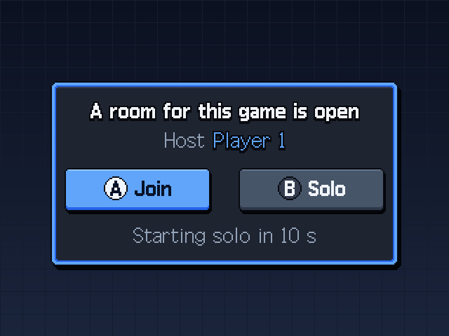
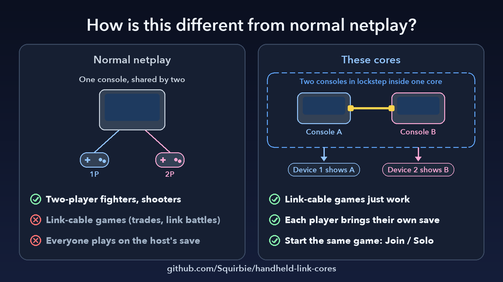
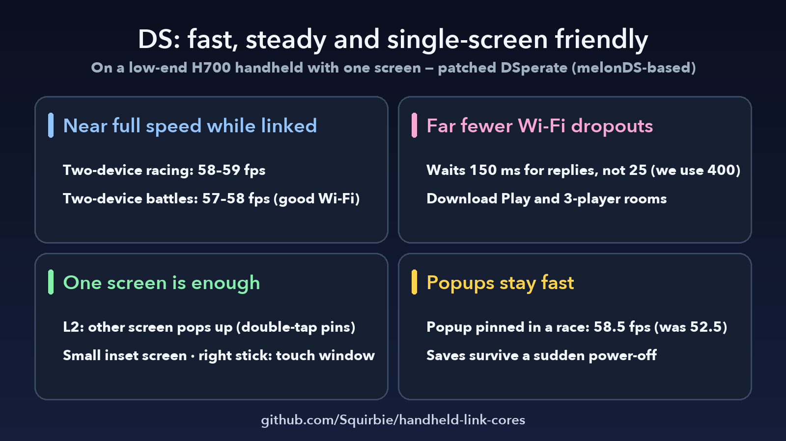
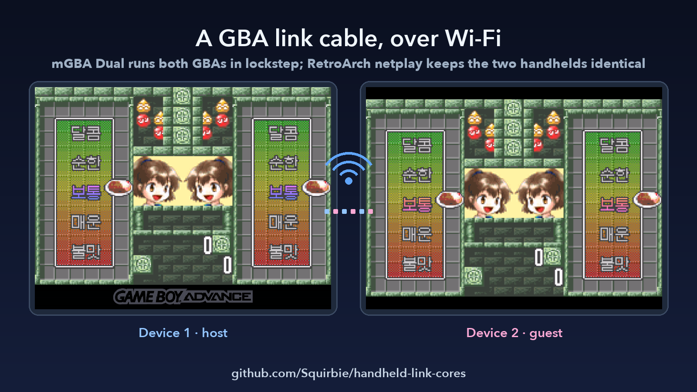
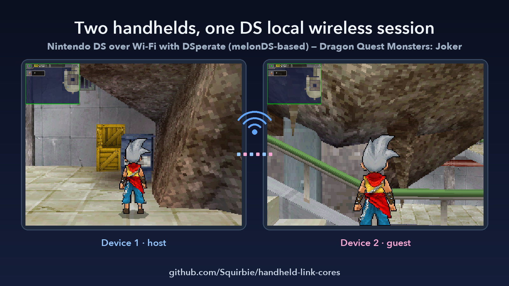
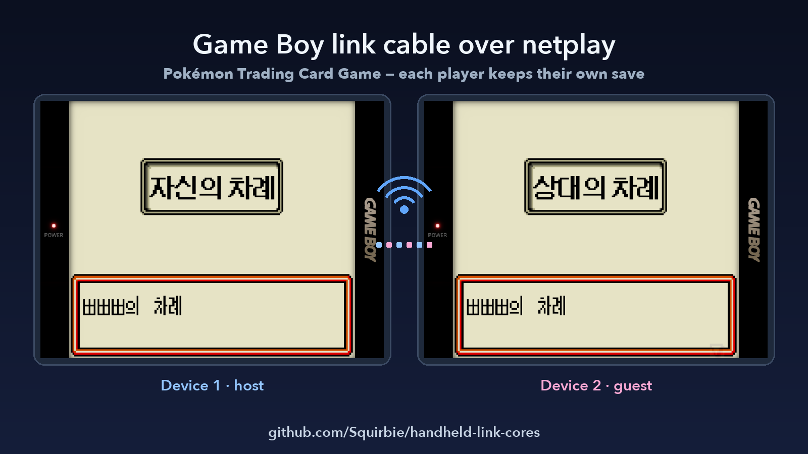
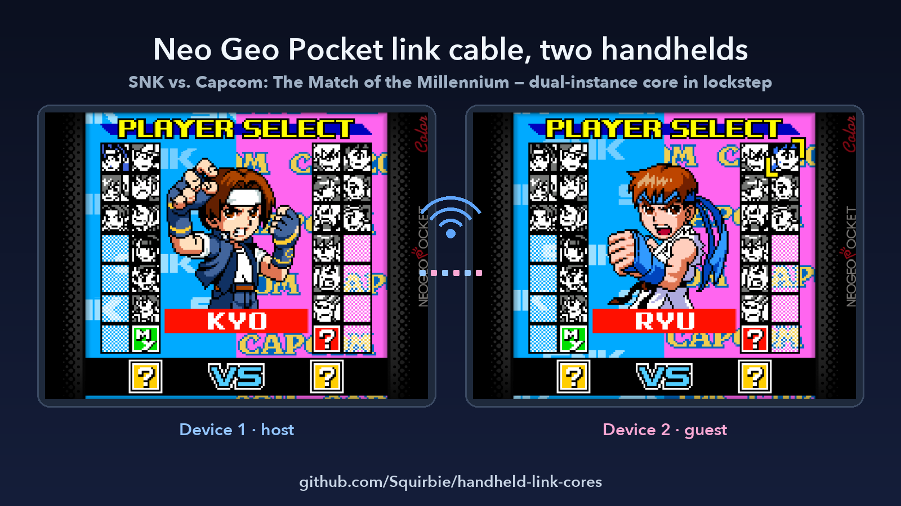
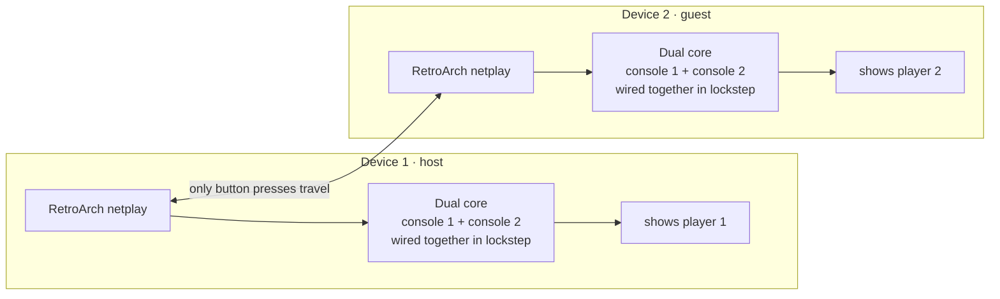

<p align="center"><a href="README.md"></a><a href="README.ko.md"></a></p>

<p align="center">
  <picture>
    <source media="(prefers-color-scheme: dark)" srcset="docs/images/banner-dark.svg">
    <source media="(prefers-color-scheme: light)" srcset="docs/images/banner-light.svg">
    
  </picture>
</p>

<p align="center">
  <a href="https://github.com/Squirbie/handheld-link-cores/releases/latest"></a>
  
  
  
  <a href="#license"></a>
</p>

<p align="center">
  <b>Play link-cable games on two handhelds, over Wi-Fi.</b><br>
  Patched emulator cores that turn RetroArch netplay into a link cable for Game Boy, Game Boy Advance, WonderSwan, Neo Geo Pocket and Game Gear,
  DS local wireless that holds up on home Wi-Fi, netplay fixes that keep arcade and MSX in sync, and DOS IPX netplay without crashes.
</p>

<p align="center">
  <a href="#highlights">Highlights</a> ·
  <a href="#whats-inside">What's inside</a> ·
  <a href="#download">Download</a> ·
  <a href="#quick-start-knulli">Quick start</a> ·
  <a href="#how-it-works">How it works</a> ·
  <a href="#faq">FAQ</a> ·
  <a href="#license">License</a>
</p>

---

## Highlights

<table>
<tr>
<td width="33%" valign="top">

**🔗 A link cable over Wi-Fi**

Two consoles run inside one core in lockstep, and RetroArch netplay keeps both devices identical. GBA, WonderSwan, Neo Geo Pocket and Game Gear link-cable games behave as if a real cable were plugged in.

</td>
<td width="33%" valign="top">

**📡 DS local wireless**

DSperate (built on melonDS) links two devices over your home network with far fewer dropouts. Download play, three-player rooms and same-game matchmaking work too.

</td>
<td width="33%" valign="top">

**🎮 Game Boy link and infrared**

Gambatte paces every byte so each game's timing window is met, and it carries the Game Boy Color infrared port as well.

</td>
</tr>
<tr>
<td width="33%" valign="top">

**💾 Everyone keeps their own save**

The guest's own save plays in the host's P2 slot and goes back to the guest when the session ends. Paired versions — two different editions that link to each other — connect too.

</td>
<td width="33%" valign="top">

**🕹️ Arcade netplay that stays in sync**

MAME 2003-Plus save states now carry the scheduler, timers, IRQ queues and board memory, so guests stop drifting. FBNeo's Taito F3 states shrink from 4.8 MB to 0.63 MB.

</td>
<td width="33%" valign="top">

**🧰 Small fixes that matter**

MSX in-game saves that stick, work RAM for NES mapper 14, DOS IPX netplay without crashes, and arcade mahjong keys on a gamepad.

</td>
</tr>
</table>

<p align="center">
  
</p>
<p align="center"><sub>Start the same game on the second device and it offers to join the room that is already open — no menus, no IP addresses. After 10 seconds it starts solo.</sub></p>

## Gallery

Real screens from two RG35XX Pro handhelds linked over Wi-Fi. Left is device 1 (host), right is device 2 (guest).

<table>
<tr>
<td width="50%"></td>
<td width="50%"></td>
</tr>
<tr>
<td></td>
<td></td>
</tr>
<tr>
<td></td>
<td></td>
</tr>
</table>

## What's inside

| System | Package | What it fixes | Based on |
|---|---|---|---|
| Nintendo DS | [`ds-melonds-ds`](cores/ds-melonds-ds/) | Maps large ROM files instead of loading them into RAM, so 256–512 MB games no longer run out of memory. Fixes two-device netplay waits (a real clock, and blank replies count as replies) and adds DraStic-style controls, layouts and a small picture-in-picture screen. | [melonDS DS](https://github.com/JesseTG/melonds-ds) v1.4.0 |
| Nintendo DS | [`ds-dsperate`](cores/ds-dsperate/) | Two-device local wireless over Wi-Fi without dropouts. A host with no guest plays solo, saves are fsync'd, same-game groups match automatically, three players can join, download play is fixed, and an IPC FIFO timing fix ends the white screen when no firmware dump is present. | [DSperate](https://github.com/beebono/DSperate) v3.0.3 |
| Game Boy / Color | [`gb-gambatte-link`](cores/gb-gambatte-link/) | Uses a RetroArch netplay room as the link cable and as the GBC infrared port. Bytes are paced to fit each game's time limits, and two Gambatte bugs are fixed: a serial byte shift and a reset while the boot ROM is mapped. | [gambatte-libretro](https://github.com/libretro/gambatte-libretro) `4041d5a` |
| Game Boy Advance | [`gba-mgba-dual`](cores/gba-mgba-dual/) | Runs two GBAs on a lockstep link cable inside one core, so link-cable games work over netplay. Linking works in any order, each player keeps their own save, paired versions link, and Single-Pak games boot player 2 from the BIOS without a cartridge. | [mgba](https://github.com/libretro/mgba) `7a12d6d` + [tangobattle/mgba](https://github.com/tangobattle/mgba) |
| Game Boy Advance | [`gba-gpsp-rfu`](cores/gba-gpsp-rfu/) | Keeps the GBA Wireless Adapter (RFU) alive through Wi-Fi lag and bursts: a 128-slot packet queue, 1.2-second disconnect detection, late replies kept, and fewer waits. Made for Pokémon FireRed, LeafGreen and Emerald trades and battles. | [gpsp](https://github.com/libretro/gpsp) `4caf7a1` |
| WonderSwan | [`wswan-mednafen-dual`](cores/wswan-mednafen-dual/) | Two WonderSwans and a rewritten serial port in one core, with save states that stay identical on both devices. Adds per-player saves, portrait screens, per-game timing, Shanghai Pocket mode and paired versions. | [beetle-wswan-libretro](https://github.com/libretro/beetle-wswan-libretro) `4b01295` |
| Neo Geo Pocket | [`ngp-mednafen-dual`](cores/ngp-mednafen-dual/) | Links two consoles through serial channel 0 and the BIOS link calls, with deterministic clock, flash and Z80 state. Adds per-player saves and paired versions (Card Fighters SNK ↔ Capcom, Dive Alert Becky ↔ Matt). | [beetle-ngp-libretro](https://github.com/libretro/beetle-ngp-libretro) `139fe34` |
| Game Gear | [`gg-genesisplusgx-dual`](cores/gg-genesisplusgx-dual/) | Emulates the Gear-to-Gear cable (parallel, UART serial and NMI) and runs two consoles line by line. Each player keeps their own save. | [Genesis Plus GX](https://github.com/libretro/Genesis-Plus-GX) `302fe82` |
| MSX | [`msx-bluemsx`](cores/msx-bluemsx/) | In-game saves (cartridge SRAM and flash) are written to files, disk swapping works, and save states are complete and repeatable, so two-device netplay no longer drifts apart. | [blueMSX-libretro](https://github.com/libretro/blueMSX-libretro) `572c918` |
| NES / Famicom | [`nes-fceumm-mapper14`](cores/nes-fceumm-mapper14/) | Gives mapper 14 (SL1632) 8 KB of work RAM and sends $6000–$7FFF writes to it, which fixes the black screen in a fan translation of Downtown Special. | [libretro-fceumm](https://github.com/libretro/libretro-fceumm) `63643ba` |
| DOS | [`dos-dosbox-pure-ipx`](cores/dos-dosbox-pure-ipx/) | Restarts DOS once when netplay begins, so IPX and the modem start clean and RetroArch no longer crashes when you host Heretic or Hexen over IPX. | [DOSBox Pure](https://codeberg.org/schelling/dosbox-pure) 0.9.9 |
| Arcade | [`arcade-mame2003-plus`](cores/arcade-mame2003-plus/) | Save states now hold the scheduler, timers, IRQ queues, CPUs and per-board video memory, so netplay guests stop going blank or drifting. Games flagged "imperfect sound" or "wrong colors" can save state again, and large read-only ROM banks stay out of states. | [mame2003-plus-libretro](https://github.com/libretro/mame2003-plus-libretro) `61305d6` |
| Arcade | [`arcade-fbneo`](cores/arcade-fbneo/) | A 9-byte machine-code patch to the stock core: EEPROM goes into netplay states, Taito F3's unused 4 MB DRAM stays out (4.8 MB → 0.63 MB), and one driver's input table no longer maps P3/P4 Start onto P2 Up/Down. | [FBNeo](https://github.com/libretro/FBNeo) v1.0.0.03 |
| Arcade | [`arcade-mahjong-pad`](cores/arcade-mahjong-pad/) | A wrapper core that answers the keyboard-only mahjong keys (A–N, Kan, Pon, Chi, Reach, Ron) from the gamepad and draws an A–N key row on screen. | wraps FBNeo and MAME 2003-Plus |

Every folder has its own README (English and Korean) with the base commit, the patches in order, core options, install steps and the upstream license.
The KNULLI glue — join prompt, per-player saves, DS direct link, PSP ad-hoc relay — lives in [`knulli-scripts/`](knulli-scripts/).

## Download

Releases are dated (`YYYY.MM.DD`). Each package is a zip with the prebuilt file(s), an `.info` file for cores with a new name, the upstream license and a short README. Checksums are in [`SHA256SUMS.txt`](https://github.com/Squirbie/handheld-link-cores/releases/latest/download/SHA256SUMS.txt).

| Package | Contents | Size |
|---|---|---|
| [**Everything**](https://github.com/Squirbie/handheld-link-cores/releases/latest/download/handheld-link-cores-all-linux-aarch64.zip) | All packages below in one zip | 44.1 MB |
| [ds-melonds-ds](https://github.com/Squirbie/handheld-link-cores/releases/latest/download/ds-melonds-ds-linux-aarch64.zip) | `melondsds_libretro.so` | 2.0 MB |
| [ds-dsperate](https://github.com/Squirbie/handheld-link-cores/releases/latest/download/ds-dsperate-linux-aarch64.zip) | `dsperate` + launch glue | 3.2 MB |
| [gb-gambatte-link](https://github.com/Squirbie/handheld-link-cores/releases/latest/download/gb-gambatte-link-linux-aarch64.zip) | `gambatte_libretro.so` | 474 KB |
| [gba-mgba-dual](https://github.com/Squirbie/handheld-link-cores/releases/latest/download/gba-mgba-dual-linux-aarch64.zip) | `mgba_dual_libretro.so` + `.info` | 387 KB |
| [gba-gpsp-rfu](https://github.com/Squirbie/handheld-link-cores/releases/latest/download/gba-gpsp-rfu-linux-aarch64.zip) | `gpsp_libretro.so` | 297 KB |
| [wswan-mednafen-dual](https://github.com/Squirbie/handheld-link-cores/releases/latest/download/wswan-mednafen-dual-linux-aarch64.zip) | `mednafen_wswan_dual_libretro.so` + `.info` | 215 KB |
| [ngp-mednafen-dual](https://github.com/Squirbie/handheld-link-cores/releases/latest/download/ngp-mednafen-dual-linux-aarch64.zip) | `mednafen_ngp_dual_libretro.so` + `.info` | 216 KB |
| [gg-genesisplusgx-dual](https://github.com/Squirbie/handheld-link-cores/releases/latest/download/gg-genesisplusgx-dual-linux-aarch64.zip) | `genesisplusgx_gg_dual_libretro.so` + `.info` | 1.7 MB |
| [msx-bluemsx](https://github.com/Squirbie/handheld-link-cores/releases/latest/download/msx-bluemsx-linux-aarch64.zip) | `bluemsx_libretro.so` | 740 KB |
| [nes-fceumm-mapper14](https://github.com/Squirbie/handheld-link-cores/releases/latest/download/nes-fceumm-mapper14-linux-aarch64.zip) | `fceumm_libretro.so` | 520 KB |
| [dos-dosbox-pure-ipx](https://github.com/Squirbie/handheld-link-cores/releases/latest/download/dos-dosbox-pure-ipx-linux-aarch64.zip) | `dosbox_pure_hb_ipx_libretro.so` | 1.2 MB |
| [arcade-mame2003-plus](https://github.com/Squirbie/handheld-link-cores/releases/latest/download/arcade-mame2003-plus-linux-aarch64.zip) | `mame2003_plus_libretro.so` | 10.0 MB |
| [arcade-fbneo](https://github.com/Squirbie/handheld-link-cores/releases/latest/download/arcade-fbneo-linux-aarch64.zip) | `fbneo_libretro.so` | 21.0 MB |
| [arcade-mahjong-pad](https://github.com/Squirbie/handheld-link-cores/releases/latest/download/arcade-mahjong-pad-linux-aarch64.zip) | `fbneo_mj_libretro.so` + `mame2003_plus_mj_libretro.so` + `.info` | 25 KB |
| [knulli-scripts](https://github.com/Squirbie/handheld-link-cores/releases/latest/download/knulli-scripts.zip) | Glue scripts, launcher patch, Galmuri pixel fonts | 2.1 MB |

No ROMs, BIOS, firmware or saves are included. Use files you are allowed to use.

## Quick start (KNULLI)

Example for **mGBA Dual**, over SSH on the device. Every package README has the exact lines for its core.

```sh
# 1) put the core in place (default folder used by the prebuilt files)
mkdir -p /userdata/system/hanbang_cores
cp mgba_dual_libretro.so /userdata/system/hanbang_cores/

# 2) let RetroArch find it — KNULLI keeps /usr in an overlay
mount -o remount,rw /
ln -sfn /userdata/system/hanbang_cores/mgba_dual_libretro.so /usr/lib/libretro/mgba_dual_libretro.so
cp mgba_dual_libretro.info /usr/share/libretro/info/   # only for cores with a new name
knulli-save-overlay
```

3. Pick the core for a game in `/userdata/system/knulli.conf` — for example `gba["My Game.gba"].core=mgba_dual` — or in the game's advanced settings in EmulationStation.
4. Do the same on the second device. **Both devices need the same core build and the same game file.**
5. Host a netplay room on one device and join it from the other — or install [`knulli-scripts/`](knulli-scripts/) to get the one-button **Join / Solo** prompt.

> [!NOTE]
> `hanbang_cores/` and `/userdata/system/claude/` are the default paths baked into the prebuilt files (the mahjong wrapper and DSperate call them). `hb_` and `hanbang` in the source mark our changes, so `grep -rn hanbang` finds every one of them.

## How it works

There are three ways to put a link cable on Wi-Fi, and each core uses the one that fits its hardware:



| Approach | Used by | What travels over Wi-Fi |
|---|---|---|
| **Dual core** — both consoles run on both devices, and each device shows its own player | GBA (mGBA Dual), WonderSwan, Neo Geo Pocket, Game Gear | Button presses only. Netplay's rollback keeps both devices identical, which is why most patches make save states exact. |
| **Netpacket** — each device runs its own console and the link traffic is sent as packets | Game Boy / Color (Gambatte), GBA Wireless Adapter (gpSP), DS (melonDS DS) | Link bytes and wireless frames, paced so games stay inside their time limits |
| **LAN multiplayer** — the emulator's own local wireless over UDP | DS (DSperate) | DS wireless frames, with Wi-Fi-friendly timing |

Arcade and MSX use plain netplay; their fixes make save states complete, so rollback does not drift. DOS uses plain netplay too; its fix restarts DOS once with IPX on when netplay begins.

## Compatibility

| Device / OS | Status |
|---|---|
| KNULLI on Allwinner H700 devices (RG35XX Pro, Plus, H, SP, 2024, RG40XX, RG CubeXX …) | Prebuilt files are made for this. Tested on two RG35XX Pro. |
| Other aarch64 Linux (muOS, ROCKNIX, Batocera …) | The cores often run as they are; if the system's glibc is older or different, rebuild from the patches. The KNULLI glue scripts need adapting. |
| Android, Windows, macOS, x86 Linux | Build from the patches for that platform. |

## Build from source

Every package folder lists the upstream repository, the base commit and a `patches/series` file. Check out the base commit, apply the patches in order and build the libretro target as usual:

```sh
git clone https://github.com/libretro/gpsp && cd gpsp
git checkout 4caf7a167d159866479ea94d6b2d13c26ceb3e72
grep -v '^#' ../handheld-link-cores/cores/gba-gpsp-rfu/patches/series | \
  while read -r p; do git apply "../handheld-link-cores/cores/gba-gpsp-rfu/patches/$p"; done
make platform=unix
```

Some folders also include an `all-in-one/` patch against the base commit. Build notes for the H700 are in each folder's README.

## Upstream status

These fixes help more people when they live upstream, so on 2026-10-29 we sent them there. The PR texts and the remaining candidates are in [`UPSTREAM.md`](UPSTREAM.md).

| Upstream | Our base | Upstream commits since | Status |
|---|---|---|---|
| melonDS DS | v1.4.0 | 0 | Branch ready ([Squirbie/melonds-ds `netpacket-wallclock-timeout`](https://github.com/Squirbie/melonds-ds/tree/netpacket-wallclock-timeout)); this project asks for PR text written by a person |
| Beetle WonderSwan | `4b01295` | 0 | Sent: [libretro/beetle-wswan-libretro#105](https://github.com/libretro/beetle-wswan-libretro/pull/105) |
| Beetle NeoPop | `139fe34` | 4 (none in our files) | Sent: [libretro/beetle-ngp-libretro#121](https://github.com/libretro/beetle-ngp-libretro/pull/121) |
| FBNeo | v1.0.0.03 | 3,389 | Sent as a two-line source fix: [finalburnneo/FBNeo#2845](https://github.com/finalburnneo/FBNeo/pull/2845) |
| DSperate | v3.0.3 | 46 | Sent (IPC FIFO timing only): [beebono/DSperate#34](https://github.com/beebono/DSperate/pull/34) |
| gambatte | `4041d5a` | 87 | Sent: [libretro/gambatte-libretro#289](https://github.com/libretro/gambatte-libretro/pull/289) |
| gpSP | `4caf7a1` | 76 | Sent (safety checks only): [libretro/gpsp#294](https://github.com/libretro/gpsp/pull/294) |
| blueMSX | `572c918` | 101 | Sent (SRAM on unload, WD2793 tags): [libretro/blueMSX-libretro#212](https://github.com/libretro/blueMSX-libretro/pull/212); the save-state completeness fixes are not sent yet |
| MAME 2003-Plus | `61305d6` | 460 | The flag-bit fix landed upstream on 2026-10-24 ([#2131](https://github.com/libretro/mame2003-plus-libretro/pull/2131)). Sent: [#2177](https://github.com/libretro/mame2003-plus-libretro/pull/2177) (H6280 / battlera, re-tested on master: 0/300 → 300/300) and [#2178](https://github.com/libretro/mame2003-plus-libretro/pull/2178) (read-only banks). The Atari and Vs. System fixes need more work on current master |
| mGBA Dual, GG Dual, FCEUmm, DOSBox Pure, Mahjong Pad | — | — | Not PR candidates: setup-specific features, or upstream rewrote the code |

## FAQ

<details>
<summary><b>Are games, BIOS or firmware included?</b></summary>

No. This repository and its releases contain only patches, documentation, scripts and prebuilt emulator files.
</details>

<details>
<summary><b>Do both devices need exactly the same files?</b></summary>

Yes. Netplay needs the same core build and the same game file on both sides (it compares CRCs). Some dual cores also refuse save states from a different build or ROM, so a mismatch shows up as a "load failed" notice instead of a silent desync.
</details>

<details>
<summary><b>Can I use the cores without the KNULLI scripts?</b></summary>

Yes. The cores work with RetroArch's normal netplay menu. The scripts add the one-button Join / Solo prompt, sending the guest's save home, the DS direct link and similar conveniences.
</details>

<details>
<summary><b>Can I sell devices with these preinstalled?</b></summary>

Not with MAME 2003-Plus, FBNeo or Genesis Plus GX: their licenses forbid commercial use. The GPL and MPL cores allow it if you follow their terms, including sharing the source — these patches.
</details>

## Contributing

Issues and pull requests are welcome, especially test reports from other devices and systems. If a fix belongs upstream, help landing it there is even better.

## License

- Each core keeps its **upstream license**, and its patches are under the same terms. The license texts are in [`LICENSES/`](LICENSES/).
- **MAME 2003-Plus, FinalBurn Neo and Genesis Plus GX are non-commercial**: you may not sell them or ship them on devices you sell.
- Our own scripts, the launcher patch and the docs are **GPL-3.0-or-later** ([`LICENSE`](LICENSE)).
- The Mahjong Pad wrapper (`hb_mjpad.c`) is offered under the same terms as the core it wraps (FinalBurn Neo license / MAME license).
- The Galmuri pixel fonts in the `knulli-scripts` package are under the SIL Open Font License 1.1.

Game and console names are trademarks of their owners. This project is not affiliated with any of them.

## Credits

[KNULLI](https://knulli.org) · [RetroArch](https://github.com/libretro/RetroArch) · [melonDS](https://github.com/melonDS-emu/melonDS) · [melonDS DS](https://github.com/JesseTG/melonds-ds) · [DSperate](https://github.com/beebono/DSperate) · [mGBA](https://github.com/mgba-emu/mgba) · [tangobattle/mgba](https://github.com/tangobattle/mgba) · [gpSP](https://github.com/libretro/gpsp) · [Gambatte](https://github.com/libretro/gambatte-libretro) · [Mednafen / Beetle](https://github.com/libretro/beetle-wswan-libretro) · [Genesis Plus GX](https://github.com/libretro/Genesis-Plus-GX) · [blueMSX](https://github.com/libretro/blueMSX-libretro) · [FCEUmm](https://github.com/libretro/libretro-fceumm) · [DOSBox Pure](https://codeberg.org/schelling/dosbox-pure) · [MAME 2003-Plus](https://github.com/libretro/mame2003-plus-libretro) · [FinalBurn Neo](https://github.com/finalburnneo/FBNeo) · [Galmuri](https://github.com/quiple/galmuri)

Thank you to everyone who built and maintains these projects.
