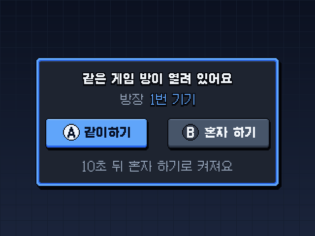

<p align="center"><a href="README.md"></a><a href="README.ko.md"></a></p>

# KNULLI 스크립트 — 코어를 둘러싼 붙이는 파일

> 코어만으로도 레트로아크 넷플레이 메뉴로 같이할 수 있어요. 이 스크립트들은 KNULLI 에서 그걸 단추 하나로 만들어요: **같이하기 창**, 손님 세이브 돌려보내기, DS 와이파이 직접 연결, PSP 애드혹 중계, 몇 가지 편의 서비스.

[](https://github.com/Squirbie/handheld-link-cores/releases/latest/download/knulli-scripts.zip) &nbsp; [← 전체 코어](../README.ko.md)

<p align="center">
  
</p>

## 들어 있는 것

| 파일 | 하는 일 |
|---|---|
| `nds_save_sync.sh` | ES 게임 시작 · 끝 훅 — 아래 도우미들을 부르는 입구예요. `/userdata/system/scripts/` 에는 **이 파일 하나만** 두세요(KNULLI 가 그 폴더의 모든 파일을 실행해요). |
| `hb_joinask.py` | **같이하기 창**. 게임을 켤 때 같은 와이파이에 같은 게임 방이 열려 있는지 묻고, 있으면 같이할지 물어요(10초 뒤 혼자). DSperate 방 · 짝 게임도 다뤄요. `system.language` 가 `ko` 로 시작하면 한국어, 아니면 영어(`HB_LANG` 으로 바꿀 수 있어요). |
| `hb_keys.py` | 창에서 A · B 단추를 읽어요(읽기만 해요 · KNULLI 에 들어 있는 python-evdev 를 써요). `hb_joinask.py` 가 불러 쓰니 둘을 같이 두세요. |
| `launcher/emulatorlauncher.patch` | KNULLI `configgen/emulatorlauncher.py` 에 거는 작은 패치: 창에서 '같이'를 고르면 손님으로 켜고, ES 넷플레이 로비로 들어온 손님도 게임별 코어를 그대로 써요. |
| `launcher/hb_patch.py` | `patch` 명령 없이 그 패치를 넣고 빼요(`patch` 가 없는 KNULLI 빌드가 있어요). 앞뒤 줄이 글자 그대로 맞을 때만 넣어요. |
| `hb_ownsave.py` | 두 대 코어(GBA · 원더스완 · 네오지오 포켓 · 게임기어)의 각자 자기 세이브: 손님 세이브가 방장 2P 칸에서 놀고 끝나면 손님에게 돌아가요. 짝 게임 표도 여기 있어요. |
| `netplay_sram_flush.py` | 넷플레이 중 게임 속 저장을 바로 파일로 써요. 같이하는 동안 CPU 를 올리는 설정도 있어요. |
| `nds_save_sync.py` | DS 세이브를 DraStic · melonDS DS · DSperate 사이에서 이어 줘요. |
| `hb_direct.py` | DS 같이하기 때 두 기기를 공유기 없이 와이파이로 바로 이어 렉을 줄여요. |
| `hb_dsmac.py` | 카드를 통째로 복사해 같아진 DS 펌웨어 MAC 을 기기마다 다르게 해요. |
| `hb_pspadhoc.py` | PSP 애드혹: 집 안 중계 서버 + 방장 자동 고르기. |
| `hb_dskeys.py` · `hb_dshold.py` · `hb_ds_remember.py` | DraStic 도우미: 버튼 도우미 · L2 누르는 동안 두 화면 바꾸기 · 게임마다 큰 화면 배치 기억. |
| `hb_idlesave.py` | 게임 중 오래 안 누르면 상태 저장하고 잠자기, 배터리가 바닥나기 직전 저장하고 끄기. |
| `hb_wifimem.py` | 와이파이 여러 개를 기억해서 스마트폰처럼 저절로 다시 붙어요. |
| `services/` | `hb_idlesave` · `hb_wifimem` · `hb_dsmac` · `hb_pspadhoc` 를 켜는 KNULLI 서비스 파일. |

## 넣는 법

가장 쉬운 길은 `sh install.sh knulli-scripts` 예요([빠르게 시작](../README.ko.md#빠르게-시작-knulli)). 아래 순서를 그대로 해 주고, 빌드의 파이썬이 3.11 이든 3.12 든 실행기를 찾아내며, `patch` 명령이 없어도 돼요.

손으로 넣을 때는 기기에 SSH 로 들어가, 푼 `knulli-scripts` 폴더에서:

```sh
# 1) 스크립트 (기본 자리: DSperate 미리 빌드 파일이 여기서 hb_direct.py · hb_joinask.py 를 불러요)
mkdir -p /userdata/system/claude
cp *.py /userdata/system/claude/
cp -r fonts /userdata/system/claude/            # 창에 쓰는 갈무리 픽셀 글꼴(OFL-1.1) — 없어도 돼요

# 2) ES 훅 — 이 폴더에는 이 파일 하나만
mkdir -p /userdata/system/scripts
cp nds_save_sync.sh /userdata/system/scripts/
chmod +x /userdata/system/scripts/nds_save_sync.sh

# 3) 실행기 패치 — '같이'를 고르면 정말 손님으로 켜지게
mount -o remount,rw /
L=$(ls /usr/lib/python3*/site-packages/configgen/emulatorlauncher.py)    # 2024년 빌드는 python3.11, 그 뒤는 python3.12
cp "$L" /userdata/system/emulatorlauncher.py.before_patch                 # 혹시 몰라 원본을 한 부 남겨요
python3 launcher/hb_patch.py apply launcher/emulatorlauncher.patch "$L"   # patch 명령이 없어도 돼요
knulli-save-overlay                                                       # 옛 KNULLI 빌드는 batocera-save-overlay

# 4) 서비스(원하면): 복사한 뒤 knulli.conf 의 system.services 에 이름을 더해요
mkdir -p /userdata/system/services
cp services/* /userdata/system/services/
```

- 창 끄기: `/userdata/system/knulli.conf` 에 `global.hb_joinask=0`, 또는 `/userdata/system/claude/hb_joinask.off` 파일을 만들어요.
- 실행기 패치 되돌리기: `python3 launcher/hb_patch.py reverse launcher/emulatorlauncher.patch "$L"` 을 실행하고 오버레이를 한 번 더 저장해요.
- 기록은 `/tmp`(램)에 남아요. 예: `/tmp/hb_joinask.log`.

## 알아 두면 좋은 것

- **와이파이가 느릴 때.** 게임을 켜면 방이 답하기를 길게는 0.8초 기다려요(2026.11.13 릴리즈 전에는 0.4초). 방이 열려 있는데도 창이 안 뜨면 `knulli.conf` 에 `global.hb_joinask_wait=1.5` 처럼 적어 더 기다리게 하세요. 0.2 ~ 3.0초 사이면 돼요. 아무도 답하지 않을 때만 그만큼 늦게 켜지고, 같은 게임 방이 답하면 바로 창이 떠요. 찾는 데 걸린 시간과 답한 방은 `/tmp/hb_joinask.log` 에 남아요.
- **비밀번호를 건 방.** 넷플레이 비밀번호나 관전 비밀번호가 걸린 방은 창이 건너뛰어요. 창에서는 비밀번호를 넣을 수 없어서예요. 집에서는 비밀번호 없이 방을 열거나, 그 방에는 넷플레이 메뉴로 들어가세요.
- **짝 게임은 파일 이름으로 맞춰요.** `hb_ownsave.py` 의 `PAIRS` 에 짝마다 롬 파일 이름(확장자 뺌)이 적혀 있어요. 대소문자는 가리지 않지만 나머지는 `(U) (V1.1)` 같은 꼬리표까지 똑같아야 해요. 두 기기 모두 그 표의 이름을 가진 파일 이름으로 바꿔 주세요. 예: `(("Pokemon - Ruby Version (U) (V1.1)", "루비"), ("Pokemon - Sapphire Version (U) (V1.1)", "사파이어")),` — 칸마다 둘째 낱말은 창에 보이는 짧은 이름이에요. 손님 기기의 같은 롬 폴더에 방장 게임도 같은 파일로 있어야 해요. `hb_joinask.py` 의 `LINK_FAMILIES` 도 같은 식으로 파일 이름을 봐요.
- **옛 KNULLI 빌드(2024 ~ 2025년).** `knulli-save-overlay` 대신 `batocera-save-overlay`, `knulli.conf` 대신 `/userdata/system/batocera.conf` 를 써요. 2024년 12월 빌드는 파이썬도 3.11 이고 `patch` 명령이 없어요. `install.sh` 와 같이하기 창은 이걸 알아서 맞춰요. 다른 스위치(`global.hb_direct` · `global.hb_ds_autopop`)와 실행기 패치의 로비 손님 부분은 아직 `knulli.conf` 만 읽어요.

## 쓰기 전에

- **RG35XX Pro 의 KNULLI** 와 그 자리에 맞춰 만들었어요. 다른 시스템에서는 경로와 훅부터 맞춰 주세요.
- 안에 든 게임 표(`hb_ownsave.py` 의 짝 게임, `hb_joinask.py` 의 짝 묶음 · 싱글팩, `../cores/ds-dsperate/glue/groups.txt` 의 DS 그룹)는 우리가 시험한 파일 이름에 맞춰져 있어요. 가진 파일 이름에 맞게 고쳐 쓰세요.
- 파일마다 맨 위에 짧은 영어 설명이 있고, 그 아래 자세한 메모는 처음 만들 때 적은 한국어 기록이에요.

## 라이선스

GPL-3.0-or-later([`LICENSE`](../LICENSE)). 릴리즈 zip 의 갈무리 글꼴은 SIL Open Font License 1.1 이에요(`fonts/Galmuri-OFL.txt`).
