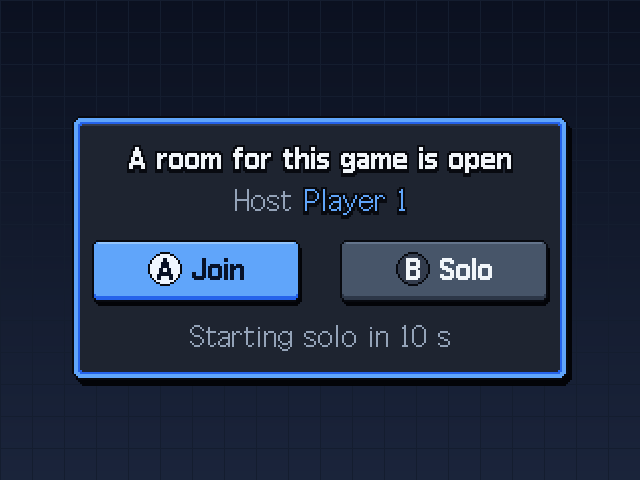

<p align="center"><a href="README.md"></a><a href="README.ko.md"></a></p>

# KNULLI scripts — the glue around the cores

> The cores work on their own with RetroArch's netplay menu. These scripts make it a one-button experience on KNULLI: the **Join / Solo** prompt, sending the guest's save home, a direct Wi-Fi link for DS, a PSP ad-hoc relay and a few quality-of-life services.

[](https://github.com/Squirbie/handheld-link-cores/releases/latest/download/knulli-scripts.zip) &nbsp; [← All cores](../README.md)

<p align="center">
  
</p>

## What's here

| File | What it does |
|---|---|
| `nds_save_sync.sh` | EmulationStation game-start / game-end hook — the entry point that calls the helpers below. It must be the **only** file in `/userdata/system/scripts/` (KNULLI runs every file there). |
| `hb_joinask.py` | The **Join / Solo** prompt. When a game starts, it asks the local network whether a netplay room for the same game is open and, if so, offers to join it (solo after 10 s). Handles DSperate rooms and paired versions too. Shows Korean when `system.language` starts with `ko`, English otherwise (override with `HB_LANG`). |
| `hb_keys.py` | Reads the A / B buttons for the prompt (read-only, through python-evdev, which KNULLI ships). `hb_joinask.py` imports it, so the two go together. |
| `launcher/emulatorlauncher.patch` | Small patch for KNULLI's `configgen/emulatorlauncher.py`: starts the guest after the prompt picked Join, and keeps the per-game core for guests joining from the ES netplay lobby. |
| `launcher/hb_patch.py` | Puts that patch in, or takes it out, without the `patch` command (some KNULLI builds have none). It only accepts an exact match of the surrounding lines. |
| `hb_ownsave.py` | Per-player saves for the dual-console cores (GBA, WonderSwan, Neo Geo Pocket, Game Gear): the guest's own save plays in the host's P2 slot and goes back to the guest afterwards. Also holds the table of paired versions. |
| `netplay_sram_flush.py` | Writes in-game saves to disk right away during netplay, with an optional CPU boost while a session runs. |
| `nds_save_sync.py` | Keeps DS saves in step between DraStic, melonDS DS and DSperate. |
| `hb_direct.py` | DS link play: connects the two devices directly over Wi-Fi (no router hop) for lower latency. |
| `hb_dsmac.py` | Gives every device its own DS firmware MAC after an SD card was cloned. |
| `hb_pspadhoc.py` | PSP ad-hoc multiplayer: a local relay server plus automatic host selection. |
| `hb_dskeys.py` · `hb_dshold.py` · `hb_ds_remember.py` | DraStic helpers: button helper, swap the screens while L2 is held, remember the large-screen layout per game. |
| `hb_idlesave.py` | Saves a state and sleeps after a long idle time in game; saves and powers off just before the battery runs out. |
| `hb_wifimem.py` | Turns off background Wi-Fi scanning while connected, which removes periodic netplay stalls (the Wi-Fi memory it is named after is switched off). |
| `services/` | KNULLI service wrappers for `hb_idlesave`, `hb_wifimem`, `hb_dsmac` and `hb_pspadhoc`. |

## Install

The quick way is `sh install.sh knulli-scripts` (see [Quick start](../README.md#quick-start-knulli)). It does the steps below, finds the launcher whichever Python the build has (3.11, 3.12, …) and needs no `patch` command.

By hand, on the device over SSH, from the unpacked `knulli-scripts` folder:

```sh
# 1) scripts (default folder: DSperate's prebuilt binary calls hb_direct.py and hb_joinask.py from here)
mkdir -p /userdata/system/claude
cp *.py /userdata/system/claude/
cp -r fonts /userdata/system/claude/            # Galmuri pixel fonts for the prompt (OFL-1.1); optional

# 2) the ES hook — keep it the only file in this folder
mkdir -p /userdata/system/scripts
cp nds_save_sync.sh /userdata/system/scripts/
chmod +x /userdata/system/scripts/nds_save_sync.sh

# 3) the launcher patch, so "Join" really starts the guest
mount -o remount,rw /
L=$(ls /usr/lib/python3*/site-packages/configgen/emulatorlauncher.py)    # python3.11 on the 2024/12 build, python3.12 on newer ones
cp "$L" /userdata/system/emulatorlauncher.py.before_patch                 # a copy of the original, just in case
python3 launcher/hb_patch.py apply launcher/emulatorlauncher.patch "$L"   # no patch command needed
knulli-save-overlay                                                       # older KNULLI builds: batocera-save-overlay

# 4) optional services: copy, then add their names to system.services in knulli.conf
mkdir -p /userdata/system/services
cp services/* /userdata/system/services/
```

- Turn the prompt off: `global.hb_joinask=0` in `/userdata/system/knulli.conf`, or create `/userdata/system/claude/hb_joinask.off`.
- Undo the launcher patch: `L=$(ls /usr/lib/python3*/site-packages/configgen/emulatorlauncher.py); python3 launcher/hb_patch.py reverse launcher/emulatorlauncher.patch "$L"`, then save the overlay again.
- Logs go to `/tmp` (RAM), for example `/tmp/hb_joinask.log`.

## Good to know

- **Slow Wi-Fi.** When a game starts, the prompt waits up to 0.8 s for a room to answer (0.4 s before release 2026.11.13). If a room is open and still no prompt appears, give it more time: `global.hb_joinask_wait=1.5` in `knulli.conf`, anything from 0.2 to 3.0 seconds. The wait only costs time when nobody answers; a room for the same game ends the search at once. `/tmp/hb_joinask.log` shows how long each search took and which rooms answered.
- **Rooms with a password.** The prompt skips rooms that have a netplay or spectator password, because it has no way to type one, so no window appears. Host without a password at home, or join that room from the netplay menu.
- **Paired versions go by file name.** `PAIRS` in `hb_ownsave.py` lists each pair by ROM file name without the extension. Upper and lower case do not matter, but everything else has to match, tags such as `(U) (V1.1)` included. Put your own names into that table on both devices, for example `(("Pokemon - Ruby Version (U) (V1.1)", "Ruby"), ("Pokemon - Sapphire Version (U) (V1.1)", "Sapphire")),` — the second word of each entry is the short name shown in the window. The guest also needs the host's game in the same ROM folder, as the same file. `LINK_FAMILIES` in `hb_joinask.py` goes by file name in the same way. An update with `install.sh` replaces both files with the new ones; the file as you had it is kept as `/userdata/system/hanbang_cores/backup/<name>.previous`, so copy your lines over again afterwards.
- **Older KNULLI builds (2024/12 – 2025).** They use `batocera-save-overlay` instead of `knulli-save-overlay` and `/userdata/system/batocera.conf` instead of `knulli.conf`; the 2024/12 build also has Python 3.11 and no `patch` command. `install.sh`, the prompt and the launcher patch handle all of that (checked against those releases' launcher sources; we have no device running such a build). Builds from before 2024/12 have a different launcher, so the launcher patch is skipped there with a warning. The other switches (`global.hb_direct`, `global.hb_ds_autopop`) still read `knulli.conf` only, and the `hb_idlesave` service calls `knulli-settings-get`, `knulli-suspend` and `knulli-shutdown`, so it only works on builds that have those commands.

## Before you use them

- They were written for **KNULLI on the RG35XX Pro** and its paths. On other systems, adjust the paths and the hook first.
- The game tables inside (paired versions in `hb_ownsave.py`, link families and Single-Pak games in `hb_joinask.py`, DS groups in `../cores/ds-dsperate/glue/groups.txt`) match file names in our test library. Edit them to match your file names.
- Each file starts with a short English summary; the detailed notes below it are the original Korean design log.

## License

GPL-3.0-or-later (see [`LICENSE`](../LICENSE)). The Galmuri fonts in the release zip are under the SIL Open Font License 1.1 (`fonts/Galmuri-OFL.txt`).
